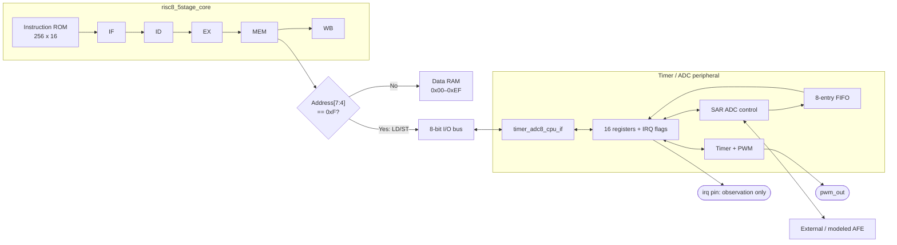
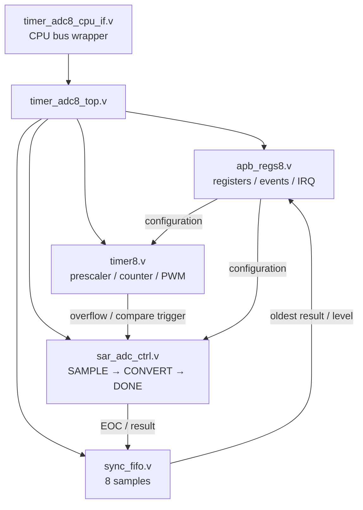
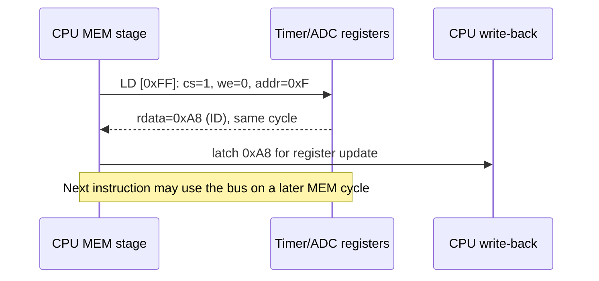
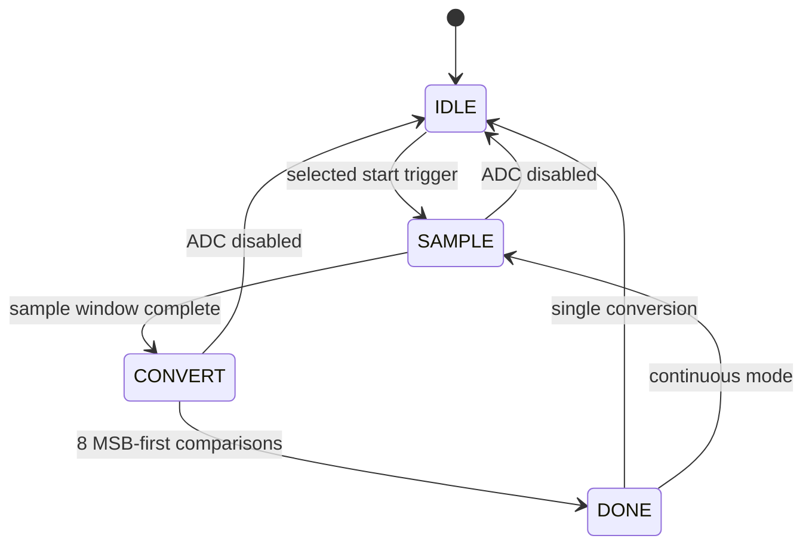

# RISC-8 SoC — 5-Stage Pipelined CPU with 8-bit Timer and SAR ADC

> A Verilog-based educational system-on-chip integrating an 8-bit, five-stage RISC processor with a memory-mapped timer, PWM generator, 8-bit successive-approximation (SAR) ADC controller, eight-entry result FIFO, and event/interrupt registers.

**Project status:** RTL integration and simulation demonstrated; FPGA synthesis completed in Vivado 2018.3. The analog front-end is modeled for simulation, not implemented as synthesizable analog hardware. The CPU currently **polls** peripheral status; hardware interrupt servicing is **not implemented**.

**Based on:** [8-bit 5-stage RISC CPU](https://github.com/Hudo1501/8bit-5stage-risc-cpu-verilog) · **Design language:** Verilog · **Evidence:** Vivado XSim screenshot and Vivado 2018.3 synthesis report; Icarus/Verilator are optional reproducibility tools (not executed in this review)

## Contents

1. [Overview](#1-overview)
2. [System architecture](#2-system-architecture)
3. [CPU and memory-mapped I/O](#3-cpu-and-memory-mapped-io)
4. [Timer, PWM, and SAR ADC](#4-timer-pwm-and-sar-adc)
5. [Register map](#5-register-map)
6. [Repository structure](#6-repository-structure)
7. [Getting started](#7-getting-started)
8. [Firmware example](#8-firmware-example)
9. [Verification and results](#9-verification-and-results)
10. [Vivado synthesis](#10-vivado-synthesis)
11. [Design considerations and limitations](#11-design-considerations-and-limitations)
12. [Roadmap and references](#12-roadmap-and-references)

## 1. Overview

This project extends an existing **8-bit Harvard-architecture RISC CPU** by connecting a digital timer and ADC peripheral to the processor's **MEM stage**. Software controls the hardware using ordinary `LD` and `ST` instructions; no new CPU opcodes are required.

| Component | Specification |
| --- | --- |
| CPU | 8-bit datapath, 16-bit fixed-width instructions, eight 8-bit general-purpose registers |
| Pipeline | Five stages: IF → ID → EX → MEM → WB |
| Hazard handling | EX/MEM and MEM/WB forwarding, one-cycle load-use stall, taken-branch flush |
| Instruction memory | 256 × 16-bit words, separate from data memory |
| CPU data address space | 256 bytes total; `0x00–0xEF` RAM, `0xF0–0xFF` peripheral registers when I/O is enabled |
| Timer | 8-bit prescaler and counter, periodic/one-shot, compare event, PWM output |
| ADC controller | 8-bit SAR, four selectable external analog channels, programmable sample time and divider |
| Result buffering | Eight-entry FIFO storing channel information and conversion data |
| Peripheral interface | One-cycle `cs`, `we`, `addr[3:0]`, `wdata[7:0]`, `rdata[7:0]` |
| Interrupt facilities | Six sticky event flags, enable mask, `irq` output; **CPU interrupt entry not implemented** |

The timer and ADC are **digital RTL**. Actual voltage sampling, DAC conversion, and comparison require an external analog front-end (AFE); the testbench supplies an AFE behavioral model.

## 2. System architecture



The `risc8_soc` module instantiates `u_cpu` and `u_tadc`. Both share `clk`; the CPU's active-high `rst` is inverted for the peripheral's active-low `rst_n`. The ADC's `adc_sample`, `adc_ch`, and `adc_dac` outputs drive an AFE, which returns `adc_cmp`.

### Internal peripheral hierarchy



## 3. CPU and memory-mapped I/O

The base CPU already performs loads and stores in the **MEM stage**. Integration adds only a page decoder, one-chip-select signal and a read-data multiplexer. All other pipeline stages and the instruction set are retained.

- `IO_ENABLE = 0` by default: the original CPU sees its normal 256-byte RAM address space. Existing CPU regression tests remain applicable.
- The SoC top uses `IO_ENABLE = 1`, `IO_PAGE = 4'hF`: addresses `0xF0–0xFF` select the peripheral; all other data addresses select RAM.
- `io_cs` is asserted **only for valid `LD` or `ST` instructions in MEM**, and only while the processor is not halted. This prevents ALU instructions containing an I/O-like address from accidentally changing peripheral state.
- A store to the I/O page must **not** also write RAM. A load from the I/O page returns `io_rdata` rather than `mem_rdata`.
- The bus has **no wait-state or ready/valid handshake**. One memory-stage access corresponds to one peripheral access. A read of `ADC_DATA` is side-effecting and pops exactly one FIFO item.

Conceptual MEM-stage logic (illustrative integration excerpt):

```verilog
wire io_hit = (IO_ENABLE != 0) && (exmem_addr[7:4] == IO_PAGE);
assign io_cs    = io_hit && (exmem_mem_we || exmem_mem_to_reg) && !halted;
assign io_we    = exmem_mem_we;
assign io_addr  = exmem_addr[3:0];
assign io_wdata = exmem_store_data;

// In the existing dmem instantiation:
// .we(mem_we && !io_hit)

wire [7:0] ld_data = io_hit ? io_rdata : mem_rdata;
wire [7:0] mem_result = exmem_mem_to_reg ? ld_data : exmem_alu_y;
```

This is **not a replacement module**: apply it to the original `risc8_5stage_core.v` and add the parameters/ports listed in the integration guide. The CPU's existing load-use hazard logic works for peripheral loads because they follow the same write-back path as RAM loads.

### Example bus timing



## 4. Timer, PWM, and SAR ADC

### Timer and PWM

`timer8.v` contains a prescaler, an 8-bit count register, an overflow event, a compare event and a PWM output. With the configuration described in the supplied design guide:

```text
Timer period (system clocks) = (TMR_PRESC + 1) × (TMR_LOAD + 1)
Nominal PWM duty fraction    = TMR_CMP / (TMR_LOAD + 1)
```

For example, `PRESC=0`, `LOAD=9`, `CMP=3` gives a ten-clock period with **30% nominal PWM duty**. Periodic and one-shot modes are available. Disabling the timer resets its counter/prescaler and drives the PWM output low.

### 8-bit successive-approximation ADC



The SAR controller performs one comparison per bit, **most significant bit first**. Its digital outputs specify the input channel (`adc_ch`), sample/hold timing (`adc_sample`), and candidate DAC value (`adc_dac`). The external AFE returns a one-bit comparator result (`adc_cmp`). A completed conversion is pushed into the eight-entry FIFO; software reads it through the memory-mapped interface.

The design guide gives the conversion timing, in system clocks, as:

```text
Conversion clocks = (ADC_SMP + 1 + 8) × (ADC_DIV + 1)
```

Example at `VREF=3.3 V`: an input of approximately `1.111 V` produces digital code `floor(1.111 / 3.3 × 256) = 86 = 0x56` in the ideal AFE model. The nominal LSB size is `3.3 V / 256 ≈ 12.9 mV`. The ADC **digital controller alone cannot measure physical voltage** without an analog front-end.

### Conversion triggers and FIFO

`ADC_CTRL.TRIG_SEL` selects the additional trigger behavior: `0` software-only, `1` timer overflow, `2` timer compare, `3` continuous mode. A write with `ADC_CTRL.START=1` generates a one-cycle software start request regardless of `TRIG_SEL`. The FIFO holds eight completed results. A push and pop on the same clock are supported; an overflow event is raised only if a full FIFO cannot accept a push (no simultaneous valid pop). Software should read `ADC_RCH` **before** `ADC_DATA`: `ADC_RCH` reports the oldest sample's validity/channel without removing it, whereas `ADC_DATA` pops the oldest sample. An explicit/selected trigger received while the ADC is busy sets `TRIG_MISS`; a result produced when the FIFO is full is dropped and sets `FIFO_OVR`.

## 5. Register map

The CPU uses `LD`/`ST` with the **full addresses** below; the peripheral itself sees only the lower four address bits.

| CPU address | Register | Access | Purpose |
| --- | --- | --- | --- |
| `0xF0` | `TMR_CTRL` | RW | Timer enable, one-shot mode |
| `0xF1` | `TMR_PRESC` | RW | Prescaler: tick every `PRESC+1` clocks |
| `0xF2` | `TMR_LOAD` | RW | Timer wrap/load value |
| `0xF3` | `TMR_CMP` | RW | Compare threshold / PWM duty control |
| `0xF4` | `TMR_CNT` | RO | Current timer count |
| `0xF5` | `ADC_CTRL` | RW | ADC enable, software start, trigger source, channel |
| `0xF6` | `ADC_SMP` | RW | Sample window minus one |
| `0xF7` | `ADC_DIV` | RW | ADC controller clock divider |
| `0xF8` | `ADC_THR_LO` | RW | Low watchdog threshold |
| `0xF9` | `ADC_THR_HI` | RW | High watchdog threshold |
| `0xFA` | `ADC_DATA` | RO, pop | Oldest ADC data; reading removes one FIFO entry |
| `0xFB` | `ADC_RCH` | RO | Oldest result valid bit (bit 7), channel (bits 1:0); no pop |
| `0xFC` | `ADC_STAT` | RO | FIFO level [3:0], EMPTY [4], FULL [5], BUSY [6] |
| `0xFD` | `IRQ_EN` | RW | Per-event IRQ enable mask |
| `0xFE` | `IRQ_STAT` | W1C | Sticky event status; write 1 to clear selected bits |
| `0xFF` | `ID` | RO | Peripheral identification value `0xA8` |

`IRQ_STAT` bits `0..5` are, respectively: `TMR_OVF`, `TMR_CMP`, `ADC_EOC`, `ADC_WD`, `FIFO_OVR`, `TRIG_MISS`. An enabled pending flag raises `irq`; the flags themselves are observable even when their interrupt enables are disabled. **`irq` does not trigger a CPU exception in this version.**

## 6. Repository structure

This release contains the **actual uploaded RTL, behavioral AFE, system testbench, and pre-assembled instruction image**, not the inferred source files used by the earlier draft. The original CPU assembler, source assembly, CPU-only testbenches, differential regression, and assertion suite were **not supplied in this upload**.

```text
risc8-5stage-timer-adc-soc/
├── .gitignore
├── LICENSE
├── README.md
├── Presentation.pdf
├── rtl/
│   ├── risc8_soc.v
│   ├── risc8_5stage_core.v
│   ├── alu.v
│   ├── control_unit.v
│   ├── hazard_unit.v
│   ├── regfile.v
│   ├── imem.v
│   ├── dmem.v
│   ├── timer_adc8_cpu_if.v
│   ├── timer_adc8_top.v
│   ├── apb_regs8.v
│   ├── timer8.v
│   ├── sar_adc_ctrl.v
│   ├── sync_fifo.v
│   ├── program.hex
│   ├── soc_demo.hex             # empty supplied file; not the SoC firmware
│   └── soc_demo.mem             # pre-assembled SoC firmware
├── tb/
│   ├── tb_risc8_soc.v
│   └── afe_model.v              # behavioral model; never synthesize
└── screenshot/
    ├── F1_Design Source.png
    ├── F2_Simulation.png
    ├── F3_TCL Console.png
    ├── F4_Elaborated Design.png
    ├── F5_Synthesized Design.png
    └── F6_Ultilization.png
```

## 7. Getting started

### Requirements

- Icarus Verilog (`iverilog`, `vvp`) for command-line simulation, **or** Vivado/XSim for GUI simulation.
- Optional GTKWave for VCD viewing.
- No Python assembler is needed to run the **supplied** SoC firmware: `soc_demo.mem` is already assembled and is read directly by `imem.v`.

Clone/download this **integrated** repository (the older CPU-only repository cannot run this SoC as-is). From the repository root, change into `rtl/` so the testbench can read `soc_demo.mem` without modifying the source:

```bash
cd rtl
iverilog -g2005 -s tb_risc8_soc -o soc.vvp *.v ../tb/afe_model.v ../tb/tb_risc8_soc.v
vvp -n soc.vvp
```

These commands use a shell that expands `*.v`, such as Bash or Git Bash. In Windows PowerShell, run the following from the repository root instead:

```powershell
Set-Location rtl
$rtlSources = Get-ChildItem -Filter *.v | Select-Object -ExpandProperty Name
iverilog -g2005 -s tb_risc8_soc -o soc.vvp $rtlSources ../tb/afe_model.v ../tb/tb_risc8_soc.v
vvp -n soc.vvp
```

To produce a VCD waveform, run from `rtl/` in Bash or Git Bash:

```bash
iverilog -g2005 -DDUMP -s tb_risc8_soc -o soc.vvp *.v ../tb/afe_model.v ../tb/tb_risc8_soc.v
vvp -n soc.vvp
gtkwave risc8_soc.vcd
```

In PowerShell, use `$rtlSources` in place of `*.v` in the waveform compilation command above.

The simulation generates `io_trace.csv`, and optionally `risc8_soc.vcd`, in the working directory (`rtl/` for these commands). Both `risc8_soc.v` and `tb/tb_risc8_soc.v` specify `"soc_demo.mem"` as the firmware filename, so run simulation where that file is readable. The firmware is tracked at `rtl/soc_demo.mem`; `rtl/soc_demo.hex` is an empty supplied file and must not be used as its replacement.

### Vivado 2018.3

1. Create an RTL project and add all 14 Verilog files in `rtl/` (eight CPU/SoC modules and six peripheral modules) as **Design Sources**.
2. Set `risc8_soc` as the synthesis top.
3. Add `tb/tb_risc8_soc.v` and `tb/afe_model.v` as **Simulation Sources**, and set `tb_risc8_soc` as the simulation top.
4. Add `rtl/soc_demo.mem` as a memory initialization source or ensure it is available in the simulator's working directory. Check the Vivado simulation log if `$readmemh` cannot open it.
5. Run Behavioral Simulation. Optionally add `-DDUMP` to Icarus to export a VCD; Vivado XSim already provides its waveform viewer.
6. Run Synthesis separately, without the non-synthesizable AFE behavioral model.

The uploaded sources do not include an `.xdc`, a board pin assignment, the original full Vivado project, or placement/routing results. This is a synthesizable **digital SoC top**, not a verified physical FPGA implementation.

### Optional CPU baseline and assertions

The prior README referenced `sw/asm8.py`, `sw/soc_demo.s`, `sw/random_test.py`, `tb/tb_risc8_5stage.v`, `tb/tb_dump.v` and `sv/timer_adc_sva.sv`. **None of those files were supplied in the latest source upload**, so their commands have been removed from the executable instructions. Restore them from an independently verified source/revision before documenting those regressions as reproducible in this repo.

## 8. Firmware example

The peripheral uses the **existing ISA**, with an address first loaded into a register:

```asm
; Read peripheral ID (should return 0xA8)
LDI R7, 0xFF
LD  R1, [R7]

; Set ADC sample window (SMP = 3)
LDI R7, 0xF6
LDI R1, 3
ST  R1, [R7]

; Start software conversion on channel 1:
; EN=bit0, START=bit1, CH=1 in [5:4] => 0x13
LDI R7, 0xF5
LDI R1, 0x13
ST  R1, [R7]
```

**Polling strategy:** load `ADC_STAT` (`0xFC`), mask bit 4 (`EMPTY`) using the regular `AND` instruction, and branch while the FIFO remains empty. Then read `ADC_RCH` (`0xFB`) before `ADC_DATA` (`0xFA`) so channel metadata corresponds to the value being popped. The ISA does **not** provide `ANDI`; load the mask into a register. Clear sticky events by writing a 1 to the corresponding `IRQ_STAT` (`0xFE`) bit.

The supplied pre-assembled `soc_demo.mem` drives the scenarios exercised by `tb_risc8_soc.v`: ID read, software-triggered ADC, timer-triggered ADC, IRQ event flags/watchdog, FIFO pop behavior and PWM. The original `soc_demo.s` assembly source was not included in the uploaded files.

## 9. Verification and results

### Test strategy

| Level | What is verified |
| --- | --- |
| CPU directed regression (historical CPU baseline) | Not rerun; CPU-only testbench not included in supplied files |
| CPU random differential regression (historical CPU baseline) | Not rerun; assembler/ISS/random regression scripts not included |
| SoC self-checking testbench | ID, ADC samples/channels, timer triggering, FIFO ordering and pop semantics, event flags, PWM duty |
| Peripheral assertions (documented in earlier PDF) | Not rerun; assertion suite not included in supplied files |
| Vivado elaboration and synthesis | Hierarchy, connectivity, synthesizeable digital logic, utilization |

### Observed simulation results

**Vivado XSim screenshot provided for this integrated project:**

```text
CPU halted after 639 cycles, 112 I/O accesses
*** SOC TEST PASSED *** (22 checks, 0 errors)
Simulation finish time: 7406 ns
```

The waveform screenshot also shows `halted=1`, `fail_cnt=0`, `pass_cnt=22`, `cycle_cnt=639`, and `io_access_cnt=112`. The terminal waveform indicates `pwm_hi_cnt=30` over a 100-clock measurement window. In the system test, the peripheral ID is `0xA8`, channel 1 produces `0x56`, and channel 2 produces `0x9B`.

**Separate historical result in the integration PDF:** 22 checks, **645 cycles and 122 I/O accesses**. This is NOT the result displayed by the uploaded testbench screenshots (639/112), and has not been independently re-executed. The current source testbench counts accesses by sampling `dut.io_cs` after each clock edge; reported counts are testbench-observed values rather than architectural instruction counters.

**Historical evidence in the supplied PDFs:** CPU directed test at 51 cycles / CPI 1.50; 500/500 random regression; 30 peripheral assertions, zero failures; Verilator lint without warnings. Those tests are **not reproducible from the files in this package alone**, and were not run during this source-to-document audit.

### Simulation artifacts

The uploaded evidence is stored under `screenshot/`:

- [F1_Design Source.png](screenshot/F1_Design%20Source.png): project design sources.
- [F2_Simulation.png](screenshot/F2_Simulation.png): simulation waveform.
- [F3_TCL Console.png](screenshot/F3_TCL%20Console.png): simulation console output.
- [F4_Elaborated Design.png](screenshot/F4_Elaborated%20Design.png): elaborated design.
- [F5_Synthesized Design.png](screenshot/F5_Synthesized%20Design.png): synthesized design.
- [F6_Ultilization.png](screenshot/F6_Ultilization.png): resource utilization (filename spelling preserved).

The project presentation is available as [Presentation.pdf](Presentation.pdf).

## 10. Vivado synthesis

The screenshots show synthesis on **Vivado 2018.3**, target `xc7k70tfbv676-1` (as displayed in the design view). These figures are from **synthesis**, not post-route timing or physical FPGA measurements.

| Hierarchy / resource | Slice LUTs | Slice registers | F7 muxes | F8 muxes |
| --- | ---: | ---: | ---: | ---: |
| `risc8_soc` total | 481 | 410 | 49 | 14 |
| `u_cpu` | 301 | 184 | 28 | 8 |
| `u_tadc` | 180 | 226 | 21 | 6 |

The screenshot also reports **25 bonded IOBs** and **1 BUFGCTRL** for the total design. Resource numbers depend on device, options, tool version and exact RTL revision. No timing closure, placed-and-routed implementation, bitstream generation or FPGA-board validation is claimed.

### Reproducing synthesis in Vivado

1. Create a new **RTL Project** and select your actual target FPGA device/board.
2. Add all 14 `rtl/*.v` source files; the peripheral modules are also directly under `rtl/`.
3. Set **`risc8_soc` as the synthesis top** (not `tb_risc8_soc`).
4. Keep the AFE model, system testbench and assertions in the **Simulation Sources** set only.
5. Set **`tb_risc8_soc` as the simulation top** and ensure firmware memory initialization paths are correct.
6. Add a valid `.xdc` file for the board's clock, package pins and I/O standard **before attempting hardware implementation**. Clock pin/period and pin mapping are board-specific and cannot be inferred from the RTL.
7. Run **RTL Elaboration → Behavioral Simulation → Synthesis**, inspect the utilization/hierarchy and timing reports; run implementation only after adding valid constraints.

**Important:** If your selected FPGA has no ADC analog front-end connected, the synthesized digital SAR controller cannot autonomously convert a voltage. The comparator input must come from suitable external circuitry, or be replaced by an appropriate FPGA-compatible ADC interface.

## 11. Design considerations and limitations

- **No CPU hardware interrupt servicing:** `irq` is exposed but there is no interrupt input/handler entry, EPC, interrupt-enable state or `RETI` instruction in the CPU. Firmware polls `ADC_STAT` / `IRQ_STAT` instead.
- **I/O page consumes RAM space:** in SoC mode, addresses `0xF0–0xFF` cannot be used as ordinary RAM.
- **Read side effects:** reading `ADC_DATA` pops a FIFO entry; select the peripheral only for an actual MEM-stage load/store. Never assert `io_cs` on arbitrary address activity.
- **Clock/reset:** CPU reset is active-high and synchronous; peripheral reset is active-low and asynchronous. A physical board should use an appropriate reset synchronizer for reset release.
- **Simple bus:** no wait states or arbitration. Adapting slower peripherals would require a bus protocol change and potentially pipeline stalls.
- **Digital-only SAR implementation:** quantization behavior in the AFE model does not prove analog accuracy, offset, DNL/INL, input bandwidth or electrical performance.
- **Synthesis ≠ hardware verification:** the available Vivado screenshots demonstrate synthesis and simulation, not successful board deployment.

## 12. Roadmap and references

Possible extensions: CPU interrupt entry/return and a small ISR; an interrupt-aware assembler and ISS; timing constraints and FPGA implementation reports; GitHub Actions for Icarus/Verilator regression; a bus protocol with backpressure; a physical AFE/board demonstration; revision-pinned simulation metrics.

### References

- [Original 8-bit 5-stage RISC CPU repository](https://github.com/Hudo1501/8bit-5stage-risc-cpu-verilog)
- *Adding the 8-bit Timer + ADC to the RISC-8 5-stage CPU* — supplied integration guide (16 pages).
- *8-bit Timer + 8-bit ADC Peripheral — Picture Guide* — supplied design guide (17 pages).
- Screenshots supplied with this project: RTL elaboration, synthesis hierarchy, utilization, XSim test output and waveform.

### Credits and license

CPU baseline: [original RISC-8 5-stage CPU repository](https://github.com/Hudo1501/8bit-5stage-risc-cpu-verilog). This project is licensed under the [MIT License](LICENSE), consistent with the original CPU repository. The copyright notice is retained in `LICENSE`.
